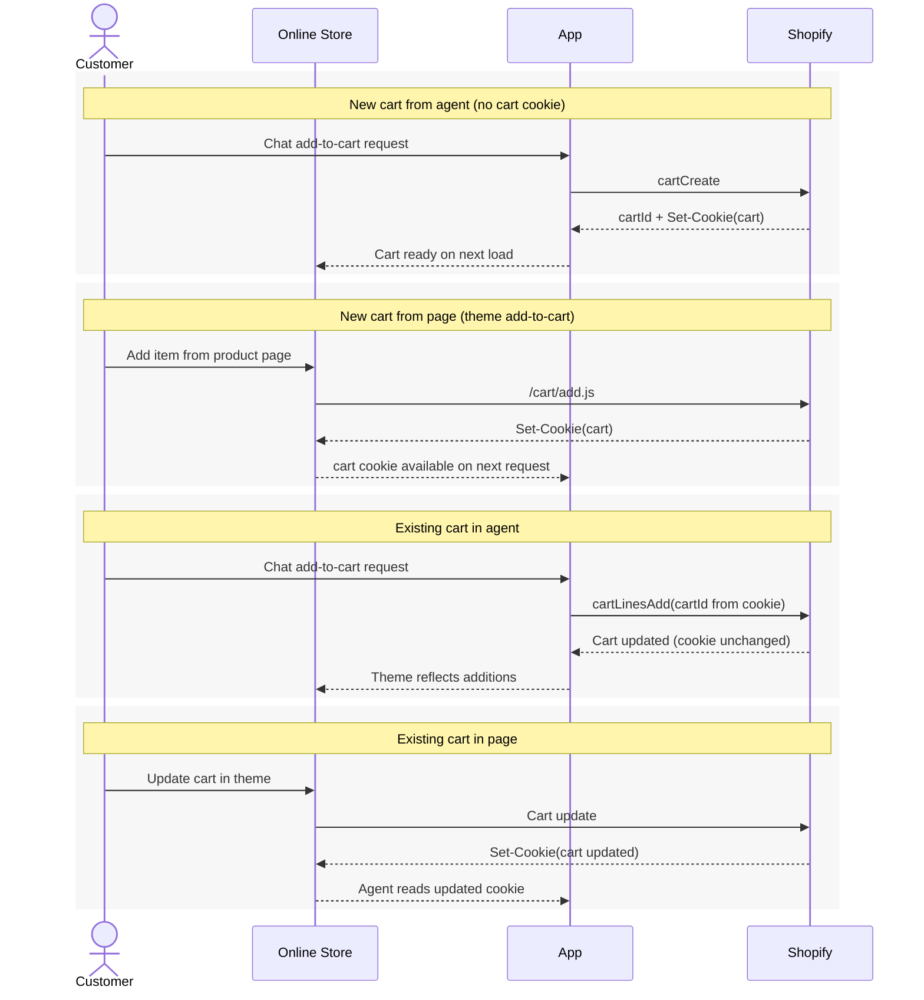

# Roadmap
## Overview
Additional features partners may want to add

### Features (in order of priority)
1. Customize sales strategy - aggressive/conservative - and boost specific products
1.5 Sync collections and boost specific collections - Smart + manual
2. Automated returns (i know this is bad - let's demonstrate)
3. Read page context and include it to agent (so we can answer questions about "this product")
4. In-app checkout using CSK

### Tech decisions
1. replace shopify's search with our own
2. replace shopify's return with our own
3. augment shopfiy's get_store_facts with our own 

## Customizations


# Chat Window Architecture

## Overview

This document describes the architecture of the chat window system in the Consumer Agent Bauer application, focusing on the data flow between the MCP (Model Context Protocol) client on the server and the UI widget in the theme extension.

## E2E Architecture `Summary

### Authenticated vs unauthenticated flows
- **Unauthenticated flow**: Public storefront tools (search, product discovery, generic cart operations) run without customer identity. Requests go from `chat.js` → `/chat` → storefront MCP or local tools.
- **Authenticated flow**: Customer-account tools (order history, profile, support) require a Customer Account token. The app uses **NCA OAuth** as a single auth surface for both the Customer Account API and the app's protected routes/tools, storing the token server-side and reusing it for authenticated MCP calls.

### Tooling split (local vs MCP)
- **MCP tools**: Remote, network-call tools exposed by MCP servers (storefront + customer). Good for shared, cross-app capabilities or when teams own tools separately.
- **Local tools**: In-process tools defined in `app/tools/*` and executed in the app runtime. We build local tools to replace existing MCP tools when we need lower latency, tighter error handling, direct DB access, better observability, or to reduce external dependencies for app-specific workflows.

### High-level data flows (by capability)
- **Discovery**: `chat.js` → `/chat` → Claude decides tool calls → storefront MCP (`search_products_*`, `search_collections`, etc.) or local product DB → results streamed back over SSE → UI renders product cards.
- **Add-to-cart**: `chat.js` → `/chat` or `/api/cart-add` → `cart.server.js` → Storefront API cart mutations → Set/refresh `cart` cookie → theme/cart UI refresh via Section Rendering API.
- **Support**: `chat.js` → `/chat` → tool requires auth → OAuth popup (NCA) → token stored server-side → customer MCP calls or local support tools → results streamed back.
- **Checkout**: Add-to-cart produces a cart with `checkoutUrl`. `chat.js` surfaces checkout link or theme cart drawer; checkout itself is handled by Shopify's hosted checkout.

### Cart continuity cases (shared cart cookie)


### Other surfaces beyond the online store
- **Assumption**: The same app can run on other surfaces as long as we can render the chat widget and provide equivalent headers/session context to `/chat`, and we accept that cart continuity depends on having access to the storefront `cart` cookie. If the surface cannot host the theme extension or expose the cart cookie, we would need a thin surface adapter (or a headless cart binding) to keep cart continuity.

## System Components

### Customer authentication (current flow)

This app uses NCA OAuth with PKCE and stores the customer access token server-side, scoped to `conversation_id`. The token is used for both customer MCP calls and app-protected routes.

## Implementation
- **Auth trigger**: Customer MCP tool calls that return 401 in `app/mcp-client.js` and local tools that call `ensureCustomerAuth` in `app/tools/tool-handler-utils.js` return an `auth_required` error with an authorization link.
- **OAuth callback**: `app/routes/auth.callback.jsx` exchanges `code` + PKCE verifier for a Customer Account API access token and stores it in Prisma `CustomerToken` keyed by `conversationId`.
- **Token lookup**: `app/mcp-client.js` and server routes read `CustomerToken` by `conversationId` to obtain the bearer.
- **Token validation**: Customer MCP `tools/list` is used to validate the bearer server-side before accessing protected data.
- **Customer MCP discovery**: `app/routes/chat.jsx` and `customer-sensitive-data.jsx` fetch `.well-known/customer-account-api` and `.well-known/openid-configuration` and cache URLs in `CustomerAccountUrls`.

## Why it’s safe (for the demo)
- Token never leaves the server; no client-side bearer usage.
- Token validity is checked by a live Customer MCP call before accessing sensitive data.
- Tokens are time-bound via `expiresAt` in Prisma.

## Gaps & recommendations for production
- `conversation_id` is a weak session identifier. Bind it to an HTTP-only cookie or a signed session token and reject mismatches.
- Store and authorize against `customerId` instead of only `conversationId`.
- Revalidate issuer/audience/shop on every use and fail closed on mismatch.
- Rate-limit protected routes to reduce brute-force risks.

## Request/data flow (with concrete endpoints & functions)
1) Auth required  
   - Trigger: customer MCP tool 401 or local tool `ensureCustomerAuth`  
   - Code: `generateAuthUrl(conversationId, shopId)` returns the OAuth URL and triggers `auth_required`.
2) OAuth callback  
   - Endpoint: GET `/auth/callback?code=...&state=...`  
   - Code: `app/routes/auth.callback.jsx` loads verifier, exchanges code at `tokenUrl`, stores token in `CustomerToken`.
3) Protected route call  
   - Endpoint: POST `/customer-sensitive-data`  
   - Input: `{ conversation_id, data }`
4) Server-side auth check  
   - Code: `app/routes/customer-sensitive-data.jsx` loads token by `conversationId`  
   - Validates token via Customer MCP `tools/list` with `Authorization: <accessToken>`
5) Sensitive data write  
   - Code: `storeCustomerSensitiveData(conversationId, JSON.stringify(payload))` writes to `CustomerSensitiveData`  
   - Response: `{ success: true, id }` on success, 401 on invalid/expired token


### 1. Frontend Components (Theme Extension)

#### Chat UI Widget (`extensions/chat-bubble/`)
- **Location**: Embedded in the storefront as a theme app extension
- **Entry Point**: `blocks/chat-interface.liquid`
- **JavaScript**: `assets/chat.js`
- **Styling**: `assets/chat.css`

The chat widget provides:
- Floating chat bubble interface
- Real-time message display with markdown formatting
- Server-Sent Events (SSE) streaming support
- Tool use visualization with expandable arguments
- Product card displays
- OAuth authentication popup handling

### 2. Backend Components (Remix App)

#### MCP Client (`app/mcp-client.js`)
- Manages connections to two MCP endpoints:
  - **Storefront MCP**: Public store data and operations
  - **Customer MCP**: Customer-specific authenticated operations
- Handles tool discovery and invocation
- Manages authentication flow for customer tools

#### Chat Route Handler (`app/routes/chat.jsx`)
- Primary API endpoint for chat interactions
- Handles SSE streaming for real-time responses
- Manages conversation state and history
- Coordinates between Claude API and MCP tools

#### Service Layer
- **Claude Service** (`services/claude.server.js`): Manages Claude API interactions
- **Streaming Service** (`services/streaming.server.js`): Handles SSE stream management
- **Tool Service** (`services/tool.server.js`): Processes tool responses and product data
- **Config Service** (`services/config.server.js`): Centralized configuration

### 3. Data Persistence

#### Database Schema (`prisma/schema.prisma`)

The application uses SQLite (via Prisma ORM) with five core models that support conversation persistence, authentication, and session management.

##### Model: Session
**Purpose**: Shopify App authentication and merchant session management

```prisma
model Session {
  id            String    @id
  shop          String
  state         String
  isOnline      Boolean   @default(false)
  scope         String?
  expires       DateTime?
  accessToken   String
  userId        BigInt?
  firstName     String?
  lastName      String?
  email         String?
  accountOwner  Boolean   @default(false)
  locale        String?
  collaborator  Boolean?  @default(false)
  emailVerified Boolean?  @default(false)
}
```

**Usage**:
- Stores Shopify merchant/admin authentication tokens
- Used by Shopify App Bridge for admin API access
- Managed automatically by `@shopify/shopify-app-remix`
- Not directly used by chat functionality (separate from customer auth)

##### Model: Conversation
**Purpose**: Top-level container for chat sessions

```prisma
model Conversation {
  id        String    @id
  messages  Message[]
  createdAt DateTime  @default(now())
  updatedAt DateTime  @updatedAt
}
```

**Usage**:
- ID format: Unix timestamp (e.g., `1767639198068`)
- Created on first message in a chat session
- Updated timestamp tracks last activity
- Parent entity for all messages in a conversation
- Enables CASCADE deletion of all related messages

**Key Operations** (`db.server.js`):
- `createOrUpdateConversation(conversationId)`: Ensures conversation exists, updates timestamp
- `getConversationHistory(conversationId)`: Retrieves all messages ordered by creation time

##### Model: Message
**Purpose**: Individual chat messages within conversations

```prisma
model Message {
  id             String       @id @default(cuid())
  conversationId String
  conversation   Conversation @relation(fields: [conversationId], references: [id], onDelete: Cascade)
  role           String       // "user" or "assistant"
  content        String
  createdAt      DateTime     @default(now())
  
  @@index([conversationId])
}
```

**Usage**:
- Stores both user inputs and assistant responses
- `role` field: `"user"` or `"assistant"`
- `content` field: Raw text content (no formatting metadata)
- Indexed by `conversationId` for efficient history retrieval
- Uses CUID for unique IDs (collision-resistant)
- Cascade deletes when parent conversation is deleted

**Key Operations** (`db.server.js`):
- `saveMessage(conversationId, role, content)`: Persists a new message
- `getConversationHistory(conversationId)`: Returns all messages in chronological order

**Data Flow**:
1. User sends message → Saved with role="user"
2. Assistant streams response → Accumulated and saved with role="assistant"
3. On page reload → History fetched and displayed in chat UI

##### Model: CustomerToken
**Purpose**: OAuth access tokens for customer-authenticated MCP tools

```prisma
model CustomerToken {
  id              String    @id
  conversationId  String
  accessToken     String
  refreshToken    String?
  expiresAt       DateTime
  createdAt       DateTime  @default(now())
  updatedAt       DateTime  @updatedAt
  
  @@index([conversationId])
}
```

**Usage**:
- Stores Shopify Customer Account API tokens
- Scoped per conversation (multiple customers can chat simultaneously)
- Tokens expire and are validated before use
- Enables authenticated operations (order history, profile updates, etc.)
- ID format: `ct_${timestamp}` (e.g., `ct_1767639198068`)

**Key Operations** (`db.server.js`):
- `storeCustomerToken(conversationId, accessToken, expiresAt)`: Upserts token for conversation
- `getCustomerToken(conversationId)`: Retrieves valid (non-expired) token

**Token Lifecycle**:
1. Tool requires auth → Returns `auth_required` signal
2. Client initiates OAuth flow → Popup window
3. Callback receives code → Exchanges for access token
4. Token stored with expiration → Associated with conversation
5. Subsequent tool calls → Token retrieved and included in MCP requests
6. Token expires → Automatic re-authentication triggered

##### Model: CodeVerifier
**Purpose**: PKCE (Proof Key for Code Exchange) state management for OAuth security

```prisma
model CodeVerifier {
  id              String    @id
  state           String    @unique
  verifier        String
  createdAt       DateTime  @default(now())
  expiresAt       DateTime
  
  @@index([state])
}
```

**Usage**:
- Implements OAuth 2.0 PKCE flow for customer authentication
- `state`: Random string linking auth request to callback
- `verifier`: Code verifier for challenge validation
- Expires after 10 minutes
- Single-use: Deleted immediately after retrieval
- ID format: `cv_${timestamp}` (e.g., `cv_1767639198068`)

**Key Operations** (`db.server.js`):
- `storeCodeVerifier(state, verifier)`: Creates verifier with 10-minute expiration
- `getCodeVerifier(state)`: Retrieves and deletes verifier (one-time use)

**PKCE Flow**:
1. Generate random `verifier` and `state`
2. Store in database with expiration
3. Create `challenge` from verifier (SHA-256 hash)
4. Redirect user to OAuth with challenge and state
5. Callback receives code and state
6. Retrieve verifier by state (validates request origin)
7. Exchange code + verifier for access token
8. Delete verifier (prevent replay attacks)

##### Model: CustomerAccountUrls
**Purpose**: Cache customer-specific MCP and OAuth endpoints per conversation

```prisma
model CustomerAccountUrls {
  id               String    @id @default(cuid())
  conversationId   String    @unique
  mcpApiUrl        String?
  authorizationUrl String?
  tokenUrl         String?
  createdAt        DateTime  @default(now())
  updatedAt        DateTime  @updatedAt
}
```

**Usage**:
- Caches customer account API endpoints discovered during conversation
- Unique per conversation (one set of URLs per chat session)
- Reduces repeated endpoint discovery calls
- Enables reconnection to same customer account after page reload

**Key Operations** (`db.server.js`):
- `storeCustomerAccountUrls({conversationId, mcpApiUrl, authorizationUrl, tokenUrl})`: Upserts URLs
- `getCustomerAccountUrls(conversationId)`: Retrieves cached URLs

**Why This Exists**:
Shopify's Customer Account API endpoints are customer-specific and discovered dynamically. Caching prevents:
- Redundant GraphQL queries to discover endpoints
- Latency on every authenticated tool call
- Potential rate limiting from repeated discovery requests

**Example URLs**:
- `mcpApiUrl`: `https://shopify.com/73263251706/account/customer/api/mcp`
- `authorizationUrl`: `https://shopify.com/73263251706/auth/oauth/authorize`
- `tokenUrl`: `https://shopify.com/73263251706/auth/oauth/token`

#### Data Model Relationships

```
Session (Shopify App Auth)
  ↓ (separate concern)
  
Conversation (1) ←──────────┐
  ├─→ Messages (many)        │
  ├─→ CustomerToken (0-1) ───┤ All scoped to conversation
  └─→ CustomerAccountUrls (0-1) ─┘
  
CodeVerifier (independent)
  └─→ Temporary OAuth state (auto-deleted)
```

**Conversation Lifecycle**:

1. **Initial State** (New Chat):
   - Conversation: Not yet created
   - Messages: Empty
   - CustomerToken: None
   - CustomerAccountUrls: None

2. **First User Message**:
   - Conversation: Created with timestamp ID
   - Messages: User message saved
   - Assistant response streamed and saved

3. **Public Tool Use** (e.g., search_products):
   - No authentication required
   - Tool results processed and returned
   - No token/URL records created

4. **Authenticated Tool Use** (e.g., get_orders):
   - First attempt: No token → Returns `auth_required`
   - CodeVerifier: Created for OAuth flow
   - OAuth popup: User authenticates
   - CustomerToken: Stored after successful auth
   - CustomerAccountUrls: Cached during auth process
   - Retry: Tool succeeds with token

5. **Subsequent Authenticated Tools**:
   - CustomerToken: Retrieved from database
   - Token validation: Check expiration
   - If expired: Trigger re-authentication
   - If valid: Include in MCP request

6. **Page Reload**:
   - Conversation: Retrieved by ID from sessionStorage
   - Messages: Loaded and displayed
   - CustomerToken: Persists across reloads
   - CustomerAccountUrls: Reused for reconnection
   - User continues conversation seamlessly

**Database Access Patterns**:

```javascript
// Chat Route (chat.jsx)
├─ On request start:
│  ├─ getConversationHistory(conversationId)
│  ├─ getCustomerToken(conversationId)
│  └─ getCustomerAccountUrls(conversationId)
│
├─ During streaming:
│  ├─ saveMessage(conversationId, "user", userInput)
│  └─ saveMessage(conversationId, "assistant", fullResponse)
│
└─ On auth required:
   ├─ storeCodeVerifier(state, verifier)
   └─ storeCustomerAccountUrls({conversationId, ...urls})

// Auth Callback (auth.callback.jsx)
├─ getCodeVerifier(state)
├─ Exchange code for token
└─ storeCustomerToken(conversationId, accessToken, expiresAt)
```

**Performance Considerations**:

1. **Indexed Queries**: 
   - `Message.conversationId` indexed for fast history retrieval
   - `CustomerToken.conversationId` indexed for token lookups
   - `CodeVerifier.state` indexed for OAuth callback validation

2. **Upsert Operations**:
   - `CustomerToken`: Updates existing or creates new (prevents duplicates)
   - `CustomerAccountUrls`: Upserts to avoid redundant records
   - `Conversation`: Updates timestamp on existing conversations

3. **Cascade Deletes**:
   - Deleting a Conversation automatically removes all Messages
   - Prevents orphaned message records
   - Simplifies cleanup operations

4. **Automatic Cleanup**:
   - `CodeVerifier`: Deleted after single use
   - Expired tokens filtered out by queries (`expiresAt > now()`)
   - No manual cleanup required for OAuth state

**Data Isolation**:

- Each conversation's data is stored separately in the database (organizational isolation)
- Database queries are scoped by conversationId to prevent accidental cross-contamination
- Multiple customers can chat simultaneously with separate tokens in different browser tabs
- ⚠️ **Security Note**: Conversation IDs are predictable timestamps, NOT cryptographically secure tokens
- ⚠️ **No Access Control**: Anyone with a conversation ID can access that conversation's data
- See [Security Considerations](#conversation-id-security-vulnerability) for critical security issues

## Data Flow Architecture

### 1. Initial Connection Flow

```
User Opens Chat → chat.js initializes
    ↓
Checks for existing conversationId in sessionStorage
    ↓
If exists: Fetches conversation history
If not: Shows welcome message
    ↓
Ready for user interaction
```

### 2. Message Processing Flow

```
User Sends Message → chat.js
    ↓
POST to /chat endpoint with:
- message
- conversation_id
- prompt_type
    ↓
Chat Route Handler (chat.jsx):
1. Validates request
2. Initializes MCP Client
3. Connects to MCP servers (storefront + customer)
4. Creates SSE stream
    ↓
Stream Processing Loop:
    ├── Claude API Stream
    │   ├── Text chunks → Client
    │   ├── Tool use requests → MCP Client
    │   └── Message completion signals
    │
    ├── MCP Tool Execution
    │   ├── Tool discovery (on connection)
    │   ├── Tool invocation
    │   ├── Auth handling (if needed)
    │   └── Result processing
    │
    └── Response Streaming (SSE)
        ├── type: 'chunk' (text fragments)
        ├── type: 'tool_use' (tool invocations)
        ├── type: 'message_complete'
        ├── type: 'product_results'
        └── type: 'end_turn'
```

### 3. MCP Tool Integration

```
Claude requests tool → Tool Service
    ↓
Determines tool location:
    ├── Storefront Tools (public)
    │   └── Direct execution
    │
    └── Customer Tools (authenticated)
        ├── Check for existing token
        ├── If missing: Return auth_required
        ├── If present: Execute with token
        └── Handle 401: Trigger auth flow
```

### 4. Authentication Flow

```
Tool requires auth → Returns auth_required
    ↓
Client receives auth_required signal
    ↓
Generates OAuth authorization URL
    ↓
Opens popup window for Shopify OAuth
    ↓
User authorizes → Callback stores token
    ↓
Token polling detects authorization
    ↓
Automatically retries original request
```

### 5. Tool Chaining (Agentic Loop)

Claude operates in an **agentic loop** where it can call multiple tools sequentially within a single conversation turn before generating a final response. This enables powerful workflows where tool descriptions instruct Claude to chain tools together.

**Example**: `search_products_preferred` instructs Claude to always call `search_collections` immediately after to enrich results with collection context.

```
User: "Show me snowboards"
    ↓
Claude decides to call search_products_preferred
    ↓
Server executes tool, streams: { type: "tool_use", tool: "search_products_preferred" }
    ↓
Tool result returned to Claude (products found)
    ↓
Claude reads tool description: "ALWAYS call search_collections after..."
    ↓
Claude decides to call search_collections with product IDs
    ↓
Server executes tool, streams: { type: "tool_use", tool: "search_collections" }
    ↓
Tool result returned to Claude (collections found)
    ↓
Claude synthesizes BOTH results into single response
    ↓
Server streams: { type: "chunk", chunk: "I found 5 snowboards..." }
    ↓
Server streams: { type: "end_turn" }
```


**Key Points**:
- No additional code needed to chain tools—Claude follows instructions in tool descriptions
- Tool results are NOT shown to the user individually; only the final synthesized response is displayed
- The loop can chain any number of tools (limited by max tokens and API constraints)
- Each tool call adds latency, so chain only when the combined result provides meaningful value

## Communication Protocols

### 1. Client → Server

**HTTP POST** to `/chat`:
```json
{
  "message": "user input",
  "conversation_id": "timestamp_id",
  "prompt_type": "standardAssistant"
}
```

### 2. Server → Client (SSE Stream)

**Event Types**:

- `id`: Conversation identifier
  ```json
  { "type": "id", "conversation_id": "123456" }
  ```

- `chunk`: Text fragment
  ```json
  { "type": "chunk", "chunk": "response text..." }
  ```

- `tool_use`: Tool invocation notification
  ```json
  { 
    "type": "tool_use", 
    "tool_use_message": "Calling tool: search_products with arguments: {...}"
  }
  ```

- `product_results`: Product display data
  ```json
  {
    "type": "product_results",
    "products": [
      {
        "id": "product_id",
        "title": "Product Name",
        "price": "$99.99",
        "image_url": "https://...",
        "url": "https://..."
      }
    ]
  }
  ```

- `message_complete`: Message finished
- `end_turn`: Conversation turn complete
- `auth_required`: Authentication needed
- `error`: Error occurred

### 3. MCP Communication

**Tool Discovery** (JSON-RPC):
```json
{
  "jsonrpc": "2.0",
  "method": "tools/list",
  "id": 1,
  "params": {}
}
```

**Tool Invocation** (JSON-RPC):
```json
{
  "jsonrpc": "2.0",
  "method": "tools/call",
  "id": 1,
  "params": {
    "name": "tool_name",
    "arguments": {}
  }
}
```

## Shared Cart Architecture

The chat widget and Shopify theme share a single cart via Shopify's native `cart` cookie mechanism. This enables seamless cart continuity between traditional storefront interactions and agent-assisted additions.

### How the Cart Cookie Works

Shopify's storefront uses a cookie named `cart` to track the active cart session. This cookie contains the cart token (optionally with `?key=...`), not a GID. Shopify manages it for theme-driven cart updates, and the app sets it when the agent creates a cart via Storefront API.

**Key Implementation Details:**
* **Cookie name**: Must be exactly `cart` (case-sensitive)
* **Cookie value**: Storefront cart token (optionally with `?key=...`), not a GID
* **Cart ID from cookie**: `c.value: hWN7NiTT8mFXH9qZz1NTUZ2w%3Fkey%3D9ee5e8a38a1c711ac1da86863cd800a7`
* **Domain scope**: Set on the shop's domain, accessible to all pages
* **AJAX API behavior**: When using `/cart/add.js`, Shopify automatically creates/updates this cookie
* **Storefront API behavior**: When creating a cart via GraphQL, the app must set this cookie using the returned cart token (client-side or via Set-Cookie)

### Cart ID normalization
The storefront cookie uses the cart token (and optional `?key=...`), while the app can keep using the Storefront GID internally.
* When reading from the cookie, strip `?key=...` before converting to a GID.
* When writing to the cookie, store only the token (and `?key=...` if present), not `gid://shopify/Cart/...`.
* App-side IDs can remain in GID format as the canonical cart identifier.

### Browser, Agent, and Shopify Data Flow

```
┌─────────────────────────────────────────────────────────────────────────┐
│                              BROWSER                                    │
├─────────────────────────────────────────────────────────────────────────┤
│                                                                         │
│  ┌──────────────────┐     ┌──────────────────┐     ┌────────────────┐  │
│  │   Theme Cart     │     │   Chat Widget    │     │  cart Cookie   │  │
│  │   (drawer/page)  │     │   (chat.js)      │     │                │  │
│  └────────┬─────────┘     └────────┬─────────┘     └───────┬────────┘  │
│           │                        │                       │           │
│           │ reads/writes           │ reads                 │           │
│           └────────────────────────┼───────────────────────┘           │
│                                    │                                    │
└────────────────────────────────────┼────────────────────────────────────┘
                                     │ sends cart ID
                                     ▼
┌────────────────────────────────────────────────────────────────────────┐
│                           AGENT SERVER                                  │
├────────────────────────────────────────────────────────────────────────┤
│                                                                         │
│  ┌─────────────────────────────────────────────────────────────────┐   │
│  │  cart.server.js                                                  │   │
│  │  ┌─────────────────┐    ┌──────────────────────────────────┐    │   │
│  │  │ If cartId:      │    │ If no cartId:                    │    │   │
│  │  │ cartLinesAdd()  │    │ cartCreate() → Set-Cookie: cart  │    │   │
│  │  └─────────────────┘    └──────────────────────────────────┘    │   │
│  └─────────────────────────────────────────────────────────────────┘   │
│                                    │                                    │
└────────────────────────────────────┼────────────────────────────────────┘
                                     │ Storefront API
                                     ▼
┌────────────────────────────────────────────────────────────────────────┐
│                              SHOPIFY                                    │
├────────────────────────────────────────────────────────────────────────┤
│  ┌────────────────┐    ┌────────────────────┐    ┌─────────────────┐   │
│  │ Cart Object    │◄───│ Storefront API     │    │ AJAX API        │   │
│  │ (persisted)    │    │ (GraphQL)          │    │ (/cart/*.js)    │   │
│  └────────────────┘    └────────────────────┘    └─────────────────┘   │
│                                                                         │
└────────────────────────────────────────────────────────────────────────┘
```

### Shared Cart Limitations

1. **Products must be published**: Only products with "Online Store" sales channel enabled can be added to the cart
2. **Cart expiration**: Storefront API carts expire after 10 days of inactivity
3. **Multi-currency**: Cart is created in the shop's default currency; changing currency may require cart recreation
4. **Inventory**: Cart does not reserve inventory; items may become unavailable before checkout
5. **Cookie scope**: Third-party cookie restrictions may affect cross-domain scenarios

## Key Design Patterns

### 1. Streaming Architecture
- Uses Server-Sent Events for real-time streaming
- Implements backpressure handling via StreamManager
- Maintains persistent connection during conversation

### 2. Tool Abstraction
- Unified tool interface regardless of MCP endpoint
- Dynamic tool discovery on connection
- Graceful degradation if MCP servers unavailable

### 3. State Management
- Session-based conversation tracking
- Database persistence for conversation history
- Token caching for authenticated sessions

### 4. Error Handling
- Graceful fallback for MCP connection failures
- Auth error detection and recovery flow
- Rate limiting and error message propagation

## Security Considerations

### Shop Resolution
The chat route determines which storefront a request originates from using HTTP headers:
- **Origin Header**: Browser-provided domain (e.g., `https://example.myshopify.com`)
- **X-Shopify-Shop-Id Header**: Client-provided shop ID from `{{ shop.id }}` in Liquid template

**⚠️ Security Warning**: Current implementation trusts client-provided headers without validation. These can be spoofed. For production, implement:
- Shopify App Proxy with HMAC signature verification, or
- Session-based authentication with server-side shop association, or
- JWT-based session tokens from Shopify App Bridge

### Conversation ID Security Vulnerability

**🔴 CRITICAL SECURITY ISSUE**: Conversation IDs are predictable and lack access control.

**The Problem**:
1. **Predictable IDs**: Conversation IDs are Unix timestamps (`Date.now().toString()`)
   - Example: `1767639198068` (milliseconds since epoch)
   - Anyone can guess valid conversation IDs by trying sequential timestamps
   
2. **No Access Control**: The history endpoint has no authentication
   ```javascript
   // chat.jsx line 54-57
   async function handleHistoryRequest(request, conversationId) {
     const messages = await getConversationHistory(conversationId);
     return new Response(JSON.stringify({ messages }));
   }
   ```
   - No validation that the requester owns the conversation
   - Anyone with a valid conversation ID can read the entire chat history
   
3. **Session Hijacking Risk**: Customer OAuth tokens are scoped to conversations
   - If an attacker guesses a conversation ID with an active customer token
   - They could potentially make authenticated requests on behalf of that customer

**Attack Scenario**:
```bash
# Attacker knows a customer was chatting around 2:00 PM on Jan 5, 2026
# They can brute force conversation IDs:
curl "https://shop.com/chat?history=true&conversation_id=1767639198000"
curl "https://shop.com/chat?history=true&conversation_id=1767639198001"
# ... eventually finding the real conversation and reading private data
```

**Impact**:
- **Data Leakage**: Attackers can read private customer conversations
- **PII Exposure**: Chat history may contain names, addresses, order details
- **Token Theft**: Active customer sessions could be hijacked
- **Compliance Risk**: GDPR/privacy violations from unauthorized data access


### Other Security Measures
1. **CORS Configuration**: Properly configured for cross-origin requests
2. **Token Management**: OAuth tokens stored securely with expiration
3. **PKCE Flow**: Code verifier for secure OAuth authorization
4. **API Key Protection**: Server-side only Claude API key storage

## Performance Optimizations

1. **Connection Pooling**: Reuses MCP connections across requests
2. **Token Caching**: Reduces authentication overhead
3. **URL Caching**: Stores customer account URLs per conversation
4. **Streaming Response**: Immediate user feedback via SSE
5. **Lazy Tool Loading**: Tools discovered only when needed

## Extension Points

1. **Custom Tools**: Add new MCP tools to either endpoint or implement local tools
2. **Prompt Templates**: Extensible system prompts in `prompts.json`
3. **UI Customization**: Theme-configurable colors and messages
4. **Authentication Providers**: Support for different OAuth providers
5. **Message Formatting**: Pluggable markdown processors

## Implementing Local Tools

While MCP servers provide a standardized way to expose tools, adding local tools directly to the application is often more efficient for app-specific functionality. Here are the recommended approaches:

### Option 1: Direct Integration in Chat Route (Recommended)

Add local tools directly in `chat.jsx` after MCP tools are loaded:

```javascript
// After line 153 where MCP tools are connected
const localTools = [
  {
    name: "calculate_shipping",
    description: "Calculate shipping costs based on location and weight",
    input_schema: {
      type: "object",
      properties: {
        weight: { type: "number", description: "Weight in kg" },
        destination: { type: "string", description: "Destination country" }
      },
      required: ["weight", "destination"]
    }
  }
];

// Merge with MCP tools
mcpClient.tools = [...mcpClient.tools, ...localTools];
```

Handle execution in the `onToolUse` callback:

```javascript
onToolUse: async (content) => {
  const toolName = content.name;
  
  // Check if it's a local tool
  if (localTools.some(tool => tool.name === toolName)) {
    const result = await executeLocalTool(toolName, content.input);
    // Process result...
  } else {
    // Existing MCP tool handling
  }
}
```

### Option 2: Extend MCPClient Class

Add local tool support to `mcp-client.js`:

```javascript
class MCPClient {
  registerLocalTools(tools) {
    this.localTools = tools;
    this.tools = [...this.tools, ...tools];
  }

  async callTool(toolName, toolArgs) {
    if (this.localTools?.some(t => t.name === toolName)) {
      return this.callLocalTool(toolName, toolArgs);
    }
    // Existing MCP routing...
  }

  async callLocalTool(toolName, toolArgs) {
    // Implement tool-specific logic
    switch(toolName) {
      case 'calculate_shipping':
        return this.calculateShipping(toolArgs);
      default:
        throw new Error(`Local tool ${toolName} not implemented`);
    }
  }
}
```

### Advantages of Local Tools

1. **No Network Overhead**: Direct function execution without HTTP requests
2. **Simpler Error Handling**: No serialization/network errors to handle
3. **Better Performance**: Immediate execution, no round-trip latency
4. **Easier Testing**: Unit test tools without mocking HTTP/MCP
5. **Type Safety**: Can use TypeScript for compile-time checking
6. **Direct Database Access**: Can use existing Prisma client directly

### When to Use Each Approach

**Use MCP Servers when:**
- Tools need to be shared across multiple applications
- Tools require isolation or different runtime environments
- External teams maintain the tools
- Tools need specific security boundaries

**Use Local Tools when:**
- Tools are specific to this application
- Performance is critical
- Tools need direct access to application state
- Simpler deployment is preferred

## Add-to-Cart Implementation

We support a single add-to-cart flow: the agent calls the Shopify add-to-cart tool. This keeps all cart changes agentic and routes through the same tool surface and cart logic.

**Files:**
* `app/tools/local-tool-definitions.js` — Shopify add-to-cart tool definition and handler
* `app/services/cart.server.js` — Cart mutation helpers and Storefront API calls
* `extensions/chat-bubble/assets/chat.js` — SSE handling + cart UI refresh

**Agentic data flow (Shopify add-to-cart tool):**
```
User says: "Add the red snowboard to my cart"
    ↓
Claude recognizes purchase intent
    ↓
Claude calls Shopify add-to-cart tool
    ├── product_id: from prior search results
    ├── variant_id: optional if user specified variant
    └── quantity: parsed from user message (default 1)
    ↓
Tool handler resolves product/variant
    ↓
Server executes cart mutation (cartCreate or cartLinesAdd)
    ↓
Server returns cart payload with checkoutUrl
    ↓
SSE event `cart_updated` updates cart cookie if needed
    ↓
Client refreshes cart UI via Section Rendering API
```

**Cart continuity (shared cart cookie):**
```
Theme cart cookie exists
    ↓
Add-to-cart tool reads existing cart ID
    ↓
cartLinesAdd mutation to same cart
    ↓
Theme cart drawer shows all items (theme + agent)
```

**Cart UI refresh (Section Rendering API):**
```
SSE event handler receives cart_updated
    ↓
Update cart cookie if a new cart was created
    ↓
Fetch sections (cart-icon-bubble, cart-drawer, cart-notification)
    ↓
Replace section HTML in DOM
```

**Checkout flows (after add-to-cart):**
```
Online store context
    ↓
Agent returns checkoutUrl link to hosted checkout
    ↓
User completes checkout in Shopify
```

```
Embedded checkout context
    ↓
Agent triggers Checkout Sheet Kit render
    ↓
Checkout sheet uses cart checkoutUrl
    ↓
User completes checkout in sheet
```

## Deployment Considerations

1. **Environment Variables**:
   - `CLAUDE_API_KEY`: Required for Claude API access
   - Database connection strings
   - OAuth client credentials

2. **Network Requirements**:
   - HTTPS for secure communication
   - WebSocket/SSE support for streaming
   - Cross-origin request handling

3. **Scaling Considerations**:
   - Stateless design enables horizontal scaling
   - Database connection pooling
   - Rate limiting per conversation

## Future Enhancements

1. **Multi-modal Support**: Image and file uploads
2. **Conversation Branching**: Alternative response paths
3. **Analytics Integration**: Usage tracking and insights
4. **Webhook Support**: Real-time store event integration
5. **Multi-language Support**: Internationalization framework
