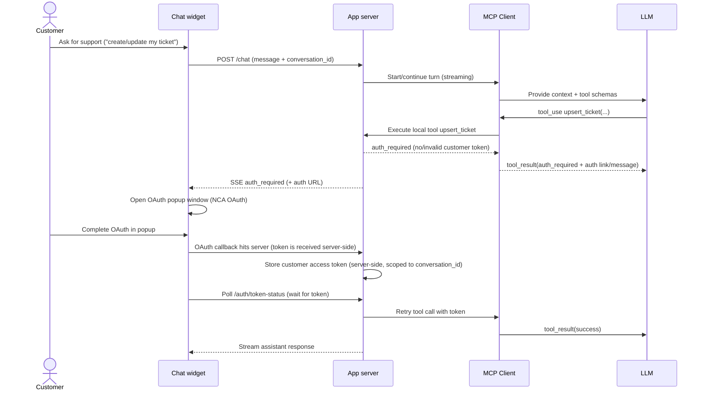

# Ecosystem Consumer Agents: Green Path Solution Proposal

Author [Riley Zammit](mailto:riley.zammit@shopify.com)  
 

Approvals:
- Graeme (re. NCA auth flow)
- Ellen re MCP
- Janet Balneaves, + JP Rose re. making the app a channel. Awaiting a decision on that requirement.

[the checkout options](https://docs.google.com/document/d/1QG7Mew3__N45kt4KhRUZrWJebLRTrR1OAo5US3vAiuQ/edit?tab=t.0#heading=h.h302sa40xl2v)

## Learnings from poc

* Partners are going to build their own customer agents, likely circumventing Shopify MCP tools in most cases. So recommendation: arrive at a set of rules we should enforce. Just one example: returns must be human-in-the-loop; another suggestion: must use Shopify cart MCPs  
* We can also customize the behaviour of the agent by including instructions in the MCP, which are then configurable by app \- e.g. after every get\_cart make suggestions for other things the customer can add based on what’s in their cart  
  * E.g. return flows can be more complex than simply request, initiate. Merchants may have custom rules such as selecting a location or return method, partial returns and/or exchanges.  
  * Custom cart experiences (FYI Shopify cart does allow for specifying specific carts  
    * Carts need to be unified between online store and agent.   
      * Building this way also allows  
    * Upsell after add-to-cart  
* Talk about UCP as a concept, not as a solution right now
* These apps are sales channels until we have channels 2.0 - advantageous positioning, 
* Can we add custom instructions to the cart MCP


### Gaps:
1. Requirements for human in the loop \- Shopify should require flows where money is exchanged to have human in the loop (i.e. returns)
2. This doc currently recommends augmenting Shopify MCPs via tool chaining, rather than replacing Shopify's tools. What's the advantage to the partner of doing this? 
3. Shopify's update_cart MCP only attributes sales to Online Store. What if the partner sells a product off Shopify? Should they attribute it as a different channel? It's definitely not an online store sale. Points++ for making these apps sales channels
4. Can't sync policy data to Shopify. Apps have their own versions, so they'll need to blend Shopify's get_faqs MCP with their own tool
5. Observability - what events do we want insight into? definitely visitor(); search_submitted via custom event?

## 1\. Purpose & Scope

Agentic commerce is shifting customer journeys from the traditional Online Store to conversational surfaces like SMS, storefront chat, and social apps. Partners are increasingly building end-to-end purchase experiences that replace parts of the Online Store, Checkout, and Customer Accounts.

This document defines the architectural "green path" for ecosystem partners (e.g., Klaviyo, Gorgias, Attentive, TikTok) building these customer-facing AI agents. It establishes a standard for integrating with Shopify’s commerce stack to ensure security, accuracy, and merchant control, preventing a fragmented "wild west" of inconsistent shopper experiences.

## 2\. E2E solution

### Prerequisites:
1. Protected customer data access
2. Scopes for NCA? (tbd)
3. Sales channel app

### Principles:

1. **Single merchant scope:** Ecosystem consumer agents are scoped to a single storefront.  
2. **Customer journey scope:** Ecosystem consumer agents support the entire purchase journey: Discovery, checkout, post purchase, and support  
3. **Platform agnostic:** Consumer agents can exist on any platform such as web/online store, web/partner surface, mobile, whatsapp, etc.  
4. **Single Source of Truth**: Partners should not attempt to reproduce Shopify core logic (discounts, markets, tax, inventory). Doing so creates maintenance nightmares and divergent pricing. Delegate this to Shopify APIs.  
5. **Agents may interface with Shopify APIs via custom tools:** unless doing so conflicts with principle 4\.  
6. **Contextual Awareness**: All product discovery and pricing must respect the customer's market context (Country \+ Language) and consent.  
7. **Checkout**: All checkouts must be done via Shopify Checkout (Web or Checkout Sheet Kit). Agents must not collect payment credentials directly in chat.  
8. **Bidirectional Data Sync:** Agents must share relevant customer and event data back to Shopify  
9. **Human in the loop:** For high-risk points such as returns humans must be in the loop.
10. **App Configuration**: Customer agents are considered Sales Channels on Shopify. Your app should be configured as a sales channel. This allows for preferential placement of the agent app in the Admin and proper checkout attribution.
11. **Single Authentication**: Apps must use Shopify's customer account login as authentication to their backend, so customers don't need to login twice.


## E2E architecture summary

The consumer agent architecture follows a server-side MCP client pattern that orchestrates multiple services:


**Architecture components:**

1. **Customer/Frontend Layer:**
   - Customers interact through a Storefront Widget (Theme App Extension or Checkout UI Extension)
   - Widget communicates with the app server via HTTPS/WebSocket with SSE streaming for real-time responses

2. **App Server (MCP Client):**
   - **Chat API Endpoint**: Handles incoming customer messages and conversation management
   - **OAuth Callback Handler**: Processes Shopify Customer Account authentication flows
   - **Tool Router**: Routes tool calls to appropriate MCP servers (Shopify or app-owned)
   - **Conversation Store**: Persists conversation history and customer tokens

3. **External Services:**
   - **LLM Provider** (Claude, GPT, etc.): Receives prompts with tool schemas and streams responses
   - **Shopify Storefront MCP**: Handles product search, cart operations, and store policies
   - **Shopify Customer Account MCP**: Manages orders, returns, and customer data (requires auth)
   - **Shopify Customer Auth Endpoint**: OAuth flow and token validation for authenticated operations on both Shopify and the app.
   - **App-Owned MCP**: Custom business logic (e.g., support tickets, custom return flows, proprietary search)

**Key data flows:**
- Customer messages flow through the widget to the app server
- App server orchestrates tool calls across multiple MCP servers
- LLM receives unified tool surface and streams responses back through the app server
- Authentication is handled server-side, with tokens stored per conversation


## 3\. Foundational patterns

These patterns are the “building blocks” that all storefront agents should compose.

### Unified cart

The agent and the online store must share a single cart. The safest baseline is to rely on Shopify’s native cart cookie semantics on the shop domain, and treat the Storefront API cart as the source of truth.

**High-level data flow**

```
Customer (any surface)
    ↓
Agent UI (chat, SMS, partner surface)
    ↓
Agent server (cart tool handler)
    ↓
Call update_cart tool
    ↓
Shopify Cart object (persisted)
    ↑
cart cookie on shop domain (shared state)
    ↑
Online store theme cart UI (drawer/page)
```


**Notes: Cart ID**: The storefront cookie is named `cart` and contains the cart token (not a Storefront GID).
**Example: Cart ID formats**

- **Cookie cart token (as stored in browser cookie):**
  - Example: `a1b2c3d4e5f67890123456789abcdef0?key=abc234sdfs23f`

- **Storefront API Cart GID:**
  - Example: `gid://shopify/Cart/a1b2c3d4e5f67890123456789abcdef0?key=abc234sdfs23f`
  - This is a global identifier string (GID) used by the Storefront API. It should be treated as the source of truth for cart ID

**Mapping:**  
When calling Storefront APIs, use the Cart GID. When accessing the cart from the shop frontend or theme, reference the value of the `cart` cookie.


### Data Sync

Agents must not be black boxes. To ensure the merchant's view of the business remains complete: Merchants need to know what queries are being asked to their store, how their products are surfaced, ensure they understand their customer’s intent/needs.

1. **Web pixels for online store**  
2. **Observability**: Online store agents should emit custom events (e.g., `discoveryActivity` or standard analytics events) when agents suggest products or facilitate sales. This ensures attribution is preserved in Shopify reports.  
3. **Data Sharing**:  
   * **Customer Identity**: Use the `visitors` API to resolve and sync user identity across sessions.  
   * **Rules / Policies for agent behaviour/context:** should all be synced into Shopify (if set in Gorgias, e.g.)

### Tool Composition: Prefer to compose and customize different tools rather than replace existing tools (single tool surface to the model)

Partners will often have proprietary tools (index search, support ticketing, policy engines). They should still use Shopify MCP tools over APIs where possible (store faqs/policies, pricing, inventory, checkout, returns objects), and merge both responses. 

Shopify's unauthenticated Storefront tools can be replaced by using the storefront API with a delegate access token. 

Shopify's authenticated Customer Accounts
Where possible, prefer to chain your tools with Shopify's tools rather than replacing them entirely.
TODO: call out areas where this might not work - i.e. returns? - NEED TO GET READ_ORDERS WORKING


Some use cases will perform better by chaining app tools with Shopify's tools rather than replacing them entirely. E.g. store_policies_and_faqs is a good example where an app should use both tools. Insturct the app_store_policies_and_faqs to chain with Shopify's store_policies_and_faqs and combine the responses.

TODO: Give a concrete example of tool chaining: 

**Example**
"After every add_to_cart, call complete_the_set"

`add_to_cart` -> `complete_the_set`


**High-level data flow**

```
Customer message
    ↓
LLM (system prompt + tool schemas)
    ↓
Tool router (one tool surface)
    ├── Local tools (in-process)
    └── Shopify MCP tools (network)
    ↓
Tool results (normalized)
    ↓
LLM response (streamed back to UI)
```

### Markets-aware indexing

Apps may prefer prefer to roll their own search functionality so merchants can customize the search behaviour, such as setting product boosts or recommending collections.

International customers expect local language, pricing, and availability. Partners should sync and query product data by the customer’s market context (country + language), and validate “hot” fields (price, availability) against Shopify. They should use contextual product feeds to do this.

TODO: Sequence diagram demonstrating contextual product feeds

**High-level data flow**

```
Merchant configuration (Markets)
    ↓
Partner app install / configuration
    ↓
Contextual catalog sync (per country + language)
    ↓
Partner index partitions (by context)
    ↓
Runtime: customer context (country + language)
    ↓
Search partner index (in that context)
    ↓
Validate price / availability via Shopify (Storefront API in-context)
    ↓
Agent response (localized, correct currency, in-stock)
```

### Customer SSO

Use Shopify Customer Accounts authentication to athenticate to the app

Customer-specific actions (order status, profile, returns initiation) require customer authentication. Agents should use [Customer Account Authentication](https://shopify.dev/docs/storefronts/headless/building-with-the-customer-account-api/authenticate-customers?extension=javascript) to SSO the customer to their app and their Shopify account using Shopify auth.  tools can declare “auth required,” and the client can complete NCA OAuth and retry.

The following example demonstrates a hypothetical support ticket flow, using the Customer account's authentication state to authenticate to the app backend.



**Token validation (server-side) pseudocode**

```javascript
function ensureCustomerAuth({ conversation_id, shop_domain, shop_id }) {
  const { mcpApiUrl } =
    resolveCustomerAccountUrls(conversation_id, shop_domain) ?? {}
  if (!mcpApiUrl) return auth_error("Missing customer MCP API URL")

  const token = getCustomerTokenFromDb(conversation_id) // { accessToken, expiresAt }
  const needsOAuth =
    !token?.accessToken || token.expiresAt <= now() || !isBearerValid(mcpApiUrl, token.accessToken)
  if (needsOAuth) return auth_required(generateAuthUrl(conversation_id, shop_id))

  return { success: true, accessToken: token.accessToken }
}

function isBearerValid(mcpApiUrl, accessToken) {
  const response = httpPost(mcpApiUrl, {
    headers: { "Content-Type": "application/json", Authorization: accessToken },
    body: { jsonrpc: "2.0", method: "tools/list", id: 1, params: {} },
  })
  return response.ok === true
}
```

**High-level data flow**

```
Customer attempts sensitive action
    ↓
LLM calls authenticated tool
    ↓
Tool execution detects missing/invalid token
    ↓
auth_required signal + OAuth URL
    ↓
Customer completes NCA OAuth (popup / redirect)
    ↓
App backend stores access token server-side
    ↓
Authenticated tool retries with token
    ↓
Sensitive result returned to LLM and UI
```


### Analytics and customer consent
Any client-side events the app wants to track must be emitted as a custom event using the web pixels API. The app then subscribes to those events. This allows the chat window to honor the customer's consent signals

```javascript
// EMIT (from theme app extension or checkout UI extension)
// Online Store context: Shopify.analytics.publish(...)
// UI Extension context: analytics.publish(...)
analytics.publish('my_app:chat_interaction', {
  action: 'message_sent',
  sessionId: '...',
  metadata: { /* custom payload */ }
});

// SUBSCRIBE (in app web pixel, runs post-consent)
analytics.subscribe('my_app:chat_interaction', (event) => {
  const { action, sessionId, metadata } = event.customData;
  // forward to analytics provider, log, etc.
});
```

### Multitouch attribution
TBD: how do we do attribution?
- Pixel + cart token?
- storefront token in Checkout URL (works for channels)
- Marketing API

On the storefront:
1. Cookie the shopify Customer ID against the cartID and your channel's attribution identifier
2. Still ensure your token is attached to the checkout URL properly for attribution
3. Map the cart token from the webhook to the checkout_completed event with the cookie (you can map checkout_completed with orders/create using token)

In an agent: Attribution works the same, except you don't need the online store part of the journey

### Universal Commerce Protocol (UCP)
As of February 2026, UCP is not the recommended path to build consumer agents into Shopify.

## 4\. Core flows

Core flows are the end-to-end user journeys (discovery, add-to-cart, checkout, post-purchase, returns, support).

### 1. Discovery

Apps must adopt storefront context: **Country**, **Language**, **Consent**, and **Identity**.

#### Agent-driven product search and discovery

Partners often want to use their own search stack for custom ranking and filtering. This is permitted, but the agent **must** validate "hot" data (real-time price, inventory) via the Storefront API before presenting results to ensure the customer doesn't try to buy an out-of-stock item.

TODO: Remove hot data validation - this should be taken care of in contextual product feed

```
sequenceDiagram
    participant Customer
    participant Agent
    participant Index as Partner Index
    participant SFAPI as Storefront API

    Customer->>Agent: "Find laptops under $1000"
    Agent->>Index: Search (Query + Context)
    Index-->>Agent: Candidate IDs [123, 456]
    Agent->>SFAPI: query { nodes(ids: [...]) { ... on Product { priceRange { minVariantPrice { amount } }, availableForSale } } }
    Note right of SFAPI: Validates price/inventory in current Context
    Agent->>Agent: Filter & Rank
    Agent->>Customer: Display Validated Results
```

**Key APIs**:

* Storefront API: `nodes(ids: [])` or `products(query: ...)` with `@inContext` directive.

#### 4.2: Online store PDP with embedded agent

**Scenario**: Customer is viewing a product page (PDP) and asks, "Will this fit my laptop?" **Goal**: Bridge the current page context to the agent just-in-time.

**Recommended Pattern (Variant B: URL/Handle Resolution):** Instead of relying on brittle DOM scraping or requiring merchants to install liquid blocks, use the URL handle to resolve the product. This allows the agent to fetch the canonical product data (dimensions, metafields) from Shopify while scraping the page for visual merchandising hints.

1. **Resolve**: Agent reads URL handle from the browser.  
2. **Fetch**: Call Storefront API (or AJAX API) to resolve handle to Product ID and fetch canonical data.  
3. **Enrich**: Scrape DOM for unstructured visual hints (badges, comparison tables, "fits X" text).  
4. **Respond**: Answer using validated API data \+ scraped context.

![][image4]

#### 4.3: Knowledge-base Q&A

**Scenario**: "What is your sustainability policy?" **Pattern**: Delegate to Shopify's standardized knowledge base.

Merchants are anxious about "hallucinating" policies. By delegating to the `search_shop_policies_and_faqs` tool, the agent ensures it only references the merchant's certified source of truth.  

Policy data should be synced to Shopify

![][image5]

**Key Tool**: `search_shop_policies_and_faqs` (Storefront MCP).

---

### Checkout

All flows must conclude via **Checkout Sheet Kit (CSK)** or standard Web Checkout. This ensures the merchant's checkout customizations (discounts, shipping logic, validators) are always respected.

#### 5.1: Embedded checkout via Checkout Sheet kit

Preferred when the conversation is taking place on a partner-owned surface outside the online store.

**Scenario**: Conversational checkout in SMS or WhatsApp. **Pattern**: Agent builds cart via MCP → Handoff to CSK.

The agent orchestrates the cart creation, adding items and setting buyer identity. When the customer is ready to buy, the agent hands off to the native Checkout Sheet Kit, providing a seamless transition from chat to secure payment.

**Inline checkout requires an app-managed auth token**   
This is required since in `inline` configuration the app has full control over checkout, so authentication ensures the app has the right to render checkouts.  
![][image6]  
**Key Tool**: `update_cart` (Storefront MCP).

#### 5.2 Redirect to web checkout

**Scenario**: Chat on Online Store. **Pattern**: Same as C1, but redirect to Web Checkout URL instead of invoking SDK.

---

### Post-purchase and support (authenticated)

Agents can dramatically reduce support costs by handling common "Where is my order?" (WISMO) and return requests, provided they use the correct APIs.

#### 6.1 Order status

**Scenario**: "Where is my order?"

```
sequenceDiagram
    participant Customer
    participant Agent
    participant API as Customer Account API

    Customer->>Agent: "Status of order #1001"
    Agent->>API: query { customer { orders(first: 1) { fulfillmentStatus, statusPageUrl } } }
    API-->>Agent: Status & Link
    Agent->>Customer: "Shipped. Track here: [Link]"
```

**Key API**: Customer Account API `customer.orders`.

#### 6.2 Returns and exchanges

**Scenario**: "I need to return this item." **Pattern**: Agent checks policy (Metaobjects) → Invokes Admin API (via App Backend/MCP) → Confirmation.

The agent acts as the interface, but the business logic (eligibility rules) should live in Shopify **Metaobjects**, and the execution (creating the return) must happen via the **Admin API**. This ensures the return is properly tracked in the merchant's admin.

```
sequenceDiagram
    participant Customer
    participant Agent
    participant Meta as Metaobjects (Policy)
    participant Admin as Admin API

    Customer->>Agent: "Return item X"
    Agent->>Meta: Check Return Eligibility Rules
    Agent->>Agent: Validate Request
    Agent->>Admin: mutation { returnRequest(...) }
    Admin-->>Agent: Return Created
    Agent->>Customer: "Return started. Here is your label."
```

**Key Resources**:

* **Config**: Metaobjects (Policy rules).  
* **Action**: Admin API `returnRequest`, `orderEdit`.  
* **Audit**: Write reasoning to Order Tags/Metafields.

#### 6.3 Orchestrate a return via Admin API (partner MCP tools)

**Scenario**: The customer wants to return 1+ items, and the partner agent should *actually create the return in Shopify* (and optionally attach a return label).

This is the “real” orchestration path: the agent never talks to Shopify Admin directly. Instead, the partner exposes **their own MCP tools** that wrap the partner’s backend implementation, which then calls Shopify’s **GraphQL Admin API** with the app’s access token.

This gives Shopify merchants an auditable return object, preserves platform invariants, and prevents partners from inventing return state machines.

#### 6.3.1 Partner MCP tool surface (recommended)

Partners should expose a small set of tools that match the Shopify return lifecycle:

* `list_returnable_fulfillment_line_items(order_id)` → resolves what can be returned (Shopify is the source of truth).  
* `calculate_return(order_id, return_line_items, return_shipping_fee?)` → optional preview (fees, taxes, refunds).  
* `request_return(order_id, return_line_items, return_shipping_fee?, notify_customer?)` → create a `REQUESTED` return (merchant approval needed).  
* `approve_return_request(return_id)` → optional (only if your product grants this capability; otherwise the merchant approves in Admin).  
* `create_return(order_id, return_line_items, return_shipping_fee?, notify_customer?)` → create an `OPEN` return (pre-approved flows).  
* `attach_return_label(return_id, label_file_url, tracking_number?, tracking_url?, notify_customer?)` → creates a reverse delivery (label \+ tracking attached).  
* `get_return(return_id)` → fetch status \+ downstream objects (reverse fulfillment orders, reverse deliveries).

#### 6.3.2 Orchestration sequence (agent → partner tools → Shopify)

![][image7]

### Scraping

#### 7.1 PDP scraping + API resolution

**Scenario**: Non-standard storefront or metaobject-heavy PDP where API lookup by handle is insufficient. **Goal**: Use scraping to *identify* the entity, then use API for *data*.

We recognize that for some complex shops, scraping is the only way to get the current context. In these cases, scraping should be used as a "pointer" to find the correct ID or SKU, which is then resolved against the Storefront API to ensure data accuracy.

```
sequenceDiagram
    participant Browser
    participant Scraper
    participant Agent
    participant SFAPI as Storefront API

    Browser->>Scraper: Extract IDs/Metaobject Keys from DOM
    Scraper-->>Agent: { "sku": "123", "custom_id": "abc" }
    Agent->>SFAPI: query { products(query: "sku:123") { ... } }
    SFAPI-->>Agent: Canonical Product Data
    Agent->>Browser: Recommendation based on API data
```

**Principle**: Scraped data is a *pointer* to the truth, not the truth itself.  


